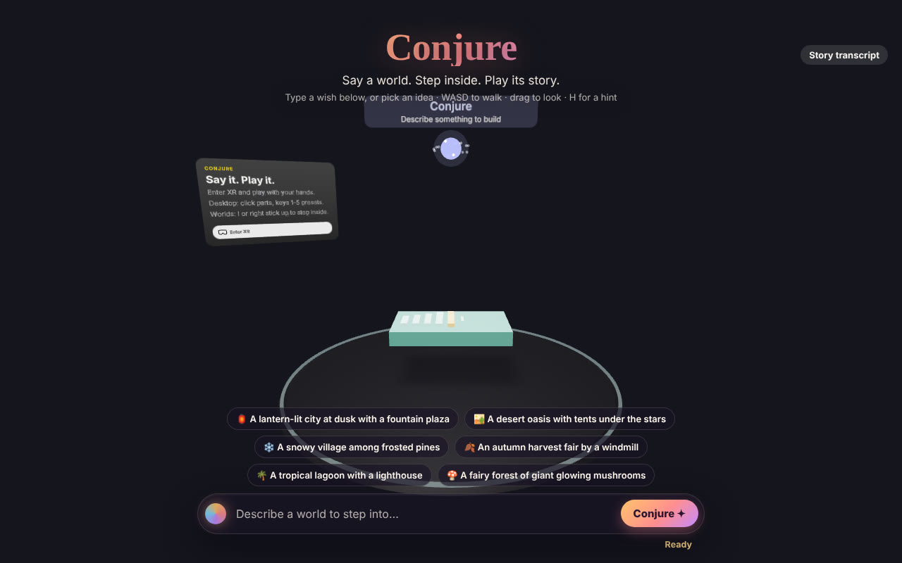
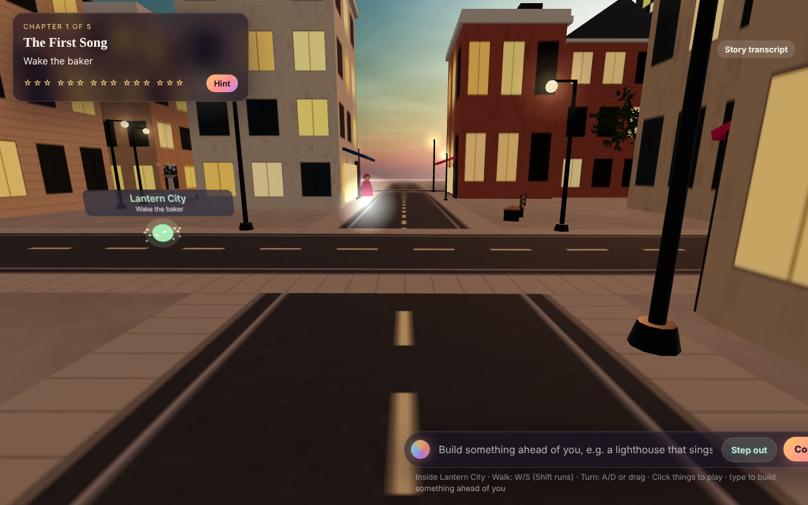
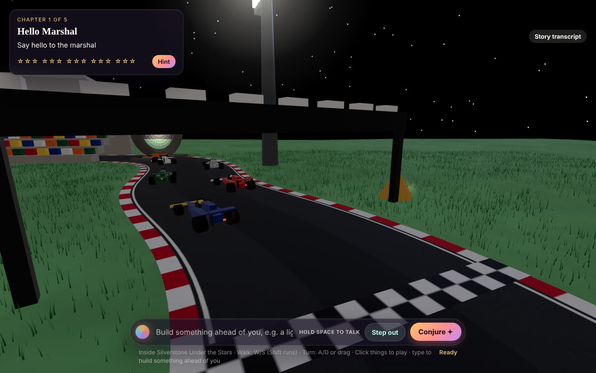
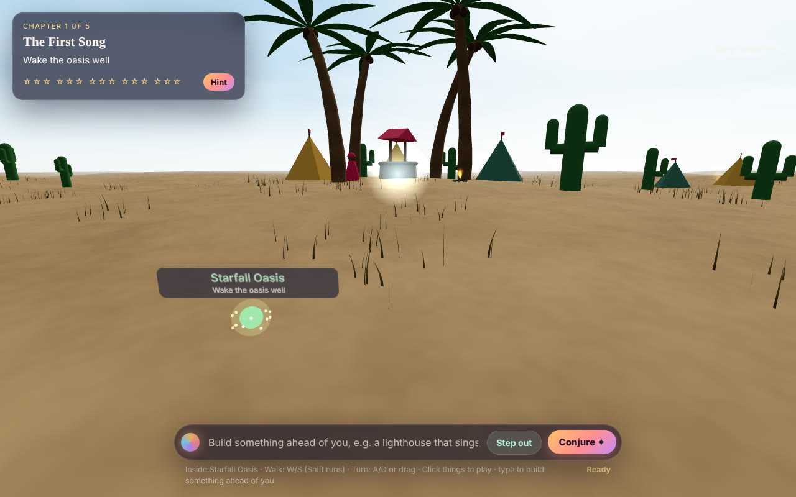
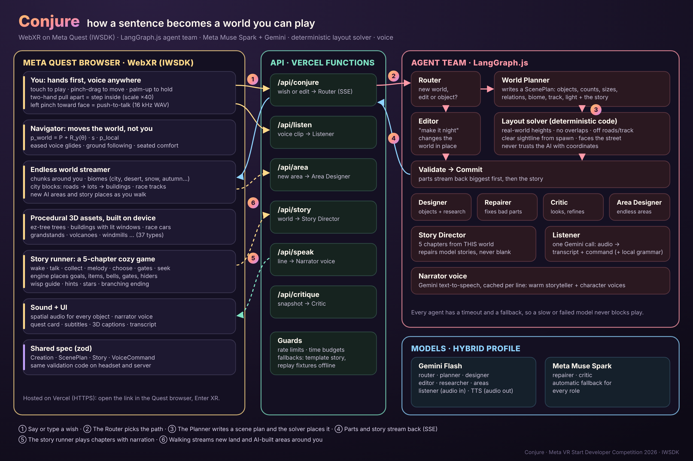

# Conjure

**Say a world. Step inside. Play its story.**

Conjure is a WebXR experience for Meta Quest. You describe any place out loud ("a cozy lantern festival in a snowy mountain village at night"), a team of AI agents builds it in front of you as a tabletop miniature, and you step inside it at life size. The world never ends, everything in it can be touched and makes a sound, and every world becomes a cozy five-chapter story game you play with your hands and your voice.

Built with Meta's **Immersive Web SDK (IWSDK)** for the **Meta VR Start Developer Competition 2026** (Gaming track, New division).

| | |
| --- | --- |
| Live | `https://conjure-chi.vercel.app` (open in the Meta Quest browser, then Enter XR) |
| Demo video | `https://youtu.be/eO9zcWevg9c` |
| Stack | WebXR · IWSDK · three.js · TypeScript · LangGraph.js · Meta Muse Spark · Gemini |



---

## Contents
- [What you can do](#what-you-can-do)
- [Worlds](#worlds)
- [The story game](#the-story-game)
- [Controls](#controls)
- [Architecture](#architecture)
- [How it works](#how-it-works)
- [Run it locally](#run-it-locally)
- [Configuration](#configuration)
- [Deploy](#deploy)
- [Project layout](#project-layout)
- [Testing](#testing)
- [Docs](#docs)
- [Credits](#credits)

---

## What you can do

1. **Say a world.** Pinch your left hand with the palm toward your face (or hold Space on desktop) and speak. You can also type in the prompt bar or tap one of the idea chips.
2. **Watch it build.** The agents plan the place and it assembles in front of you, biggest things first. Turn your left palm up and the miniature floats onto your hand.
3. **Step inside.** Pinch with both hands and pull apart: the world grows forty times to life size around you.
4. **Explore forever.** New land streams in as you walk, and AI agents design new areas as you approach them. Touch anything: a volcano erupts, a windmill spins, a fountain sprays, a villager hops and hums.
5. **Play its story.** A narrator voices a five-chapter quest written for this world, with a quest card, subtitles, a guiding wisp, hints and stars.
6. **Keep creating from inside.** "Create a boat", "put a hot-air balloon over there", "make it night".

Designed for **seated, hands-first** play: everything is within arm's reach, controllers are optional, and a full story takes under ten minutes.

## Worlds

Every world has a **biome** that sets the ground, grass, sky haze and the props that fill the endless land around it: `meadow`, `forest`, `autumn`, `snow`, `desert`, `tropical`, `city`, `village`, `fantasy`.

| City | Race circuit | Desert |
| --- | --- | --- |
|  |  |  |

- **Cities** follow the classic procedural-city pipeline: streets with sidewalks along every block, then lots, then buildings (brick and plaster houses and glass towers with lit windows, facing the street), then street furniture (lamps, parked cars, benches). Block centres become pocket parks, fountain plazas or markets.
- **Race tracks.** Racing wishes ("Silverstone", "Formula 1", "grand prix", "speedway") add a circuit or an oval looping around the world: kerbs, a chequered start line, a start-lights gantry, cars on the grid, grandstands with a crowd, pit garages, floodlights and tyre walls. You land on the grid looking down the start straight.
- **Real places** are built from their signature features rather than as a generic town.

More than 40 procedural asset types are built in code on the device (no model downloads): trees (via ez-tree), buildings, skyscrapers, cottages, castles, lighthouses, volcanoes, mountains, cars, race cars, grandstands, floodlights, windmills, fountains, market stalls, tents, cacti, hot-air balloons, characters and more. Each has a default sound and reaction.

## The story game

Every world gets a five-chapter story. Chapter 1 and chapter 5 happen at home; chapters 2 to 4 happen in new places the engine builds in a direction away from home, and must be three different kinds.

| Kind | What you do |
| --- | --- |
| `wake` | Touch something to bring it to life |
| `talk` | Touch a character; they answer in their own voice |
| `collect` | Gather 3 to 4 items around a new place |
| `melody` | Listen to a tune on bells, then play it back |
| `gates` | Pass through glowing gates in order (on a race track, around the lap) |
| `seek` | Hide and seek: a shy friend hides three times |
| `choose` | Pick one of two options; the choice changes the ending |

The engine places its own goals, items, bells, gates and hiders, so a chapter never depends on the AI remembering to include them. You earn up to three stars per chapter (a hint or a slow chapter costs one), an automatic hint arrives after 50 seconds, and the next chapter's place is built while you play the current one.

## Controls

### Hands (no controller needed)

| Gesture | Action |
| --- | --- |
| Tap with a fingertip | Play an object; complete story goals |
| Pinch at a distance | Select an object out of reach |
| Pinch the air and drag | Pull the world toward you (move) |
| Two-hand pinch | Rotate and resize the tabletop world |
| Pull hands apart past about 2.5× | Step inside at life size |
| Bring hands together | Step back out |
| Left palm up | Hold the miniature on your hand |
| Left pinch, palm toward your face | Push-to-talk |

### Controllers (optional)
Left stick walks, right stick snap-turns, right stick up or down steps in or out, grip drags the world, **X / Y** is push-to-talk.

### Voice

| Say | Action |
| --- | --- |
| "A snowy village among frosted pines" | Build a new world |
| "Make it night", "add more trees", "create a boat" | Edit the world or build in front of you |
| "Take me to the fountain" | Glide there and face it |
| "Walk forward", "keep walking", "stop", "turn around", "go north", "faster" | Move |
| "Where next?", "take me home" | Travel to the story's next place, or back to the start |
| "Hint", "say that again" | Story help |
| "The lantern one", "the second one" | Make a story choice |
| "Step inside", "step out" | Change scale |

### Desktop and emulator keys

| Key | Action |
| --- | --- |
| Hold **Space** (or hold the orb) | Push-to-talk |
| **W / S**, **A / D**, **Shift**, mouse drag | Walk, turn, run, look |
| **I** | Step inside or out |
| **H** | Hint |
| **T** | Story transcript |
| **K** | Toggle the sky (see your room around the world) |
| **R** | Recenter |
| **P** | Replay the assembly |
| **1** to **5** | Presets: kalimba, drum kit, jellyfish, xylophone, Volcano Isle |

## Architecture



Two halves share one set of schemas (`src/spec/`, validated with zod), so the headset and the server check exactly the same data:

- **Headset (WebXR, IWSDK).** Input, navigation, the streamed world, procedural assets, the story runner, audio and UI.
- **Agent server (LangGraph.js).** Serverless functions under `api/` that run the agents and stream results back as server-sent events.

### The agent team

| Agent | Job | Model (hybrid profile) |
| --- | --- | --- |
| Router | New world, edit, or single object? | Gemini Flash |
| World Planner | Writes a *scene plan*: objects, counts, sizes, spatial relations, biome, track, light and the story | Gemini Flash |
| Editor | Changes a world in place | Gemini Flash |
| Designer + Researcher | Single objects and instruments, after looking up the real thing | Gemini Flash |
| Area Designer | New areas and story places as you explore | Gemini Flash |
| Story Director | Writes or repairs a five-chapter story | Gemini Flash |
| Repairer | Fixes invalid parts until the creation validates | Meta Muse Spark |
| Critic | Looks at a snapshot and refines the creation once | Meta Muse Spark |
| Listener | Voice clip → transcript + command | Gemini (audio input) |
| Narrator voice | Storyteller and character voices | Gemini text-to-speech |

Every role can fall back to the other provider, and every agent has a timeout and a fallback (a template story, replay fixtures), so a slow or failed model never blocks play.

### API

| Endpoint | Purpose |
| --- | --- |
| `POST /api/conjure` | A wish or an edit → stream of stages, parts and the story (SSE) |
| `POST /api/area` | A new area of the endless world (SSE) |
| `POST /api/story` | A story for any world |
| `POST /api/listen` | A push-to-talk clip → transcript + command |
| `POST /api/speak` | A narration line → WAV audio |
| `POST /api/critique` | A snapshot → one refinement |
| `GET /api/health` | Status |

## How it works

### The AI never writes coordinates
The World Planner describes the scene in words and relations ("houses around the well", "pines scattered in the north", "grandstands trackside"). A deterministic **layout solver** (`src/spec/scene.ts`), in the spirit of Holodeck, decides exactly where everything goes:
- sizes each object from its real-world height (a cottage is about 6 m, a pine about 11 m, a person 1.75 m);
- places by relation with rejection sampling, so nothing overlaps;
- keeps things on dry land and off roads and the race track, and turns buildings to face the street;
- sends big landmarks to the horizon so they never swallow the village;
- keeps a clear line of sight from where you land to the heart of the world.

### Moving the world, not the user
The whole world hangs from one anchor, posed each frame as

```
p_world = P + R_y(θ) · s · p_local
```

so walking, turning, scaling the miniature to life size (s = 40: one world unit becomes 40 m) and voice travel are all eased changes of (P, θ, s). The world follows the ground under your head, and solid objects gently push you around them (`src/world/navigator.ts`).

### An endless streamed world
The ground is split into 25 m chunks that load in rings around you (`src/world/streamer.ts`, `src/engine/chunks.ts`). Each chunk scatters the world's own props deterministically, so the same trees stand in the same places when you come back. Cities generate a block per chunk (`src/engine/city.ts`), race tracks are one loop shared by the solver, the renderer and the story (`src/engine/track.ts`), and AI areas are requested for new land with a rate limit.

### Voice
The Quest browser has no built-in speech recognition or synthesis, so both run on the server. The headset records push-to-talk audio as 16 kHz mono WAV and ends the clip after a short silence (`src/voice/mic.ts`). One Gemini call hears the clip and returns a transcript and a structured command (`server/listen.ts`). Short control phrases are also matched by an on-device grammar (`src/spec/voice.ts`), so "stop" never depends on the model. Voice travel is an eased glide of about 10 m/s, never longer than 3.5 s.

### Narration and sound
Narration uses Gemini text-to-speech with a storyteller voice and a character voice, cached per line (`server/tts.ts`). Every object has spatial sound, and an ambient soundscape (wind, waves, birds, crickets, footsteps) follows the biome.

## Run it locally

Requirements: Node 20.19+ or 22.12+, a Chromium browser, and optionally a Meta Quest on the same network.

```bash
npm install
cp .env.example .env.local   # add your keys (see Configuration); no keys = replay mode
npm run server               # agent server (LangGraph.js) on :8787
npm run dev                  # IWSDK dev server + Quest emulator, proxies /api to :8787
```

- **Desktop:** open the dev URL, then type a wish or hold Space and speak. Use the emulator's **Enter XR** and Play mode to try hands and controllers.
- **Quest:** open `https://<your-computer's-IP>:8081` in the Meta Quest browser, accept the certificate, **allow the microphone on the flat page first** (hold the orb once), then **Enter XR**.

With no API keys the server runs in **replay mode**: fixtures and the built-in presets, no live generation.

## Configuration

Set these in `.env.local` (never commit it):

| Variable | Purpose |
| --- | --- |
| `MODEL_API_KEY` | Meta Model API key (Muse Spark) |
| `GOOGLE_API_KEY` | Gemini key (planning, voice input, narration) |
| `LLM_PROFILE` | `hybrid` (default with both keys), `meta` or `gemini` |
| `LLM_DEFAULT`, `LLM_<ROLE>` | Model per role, e.g. `LLM_DESIGNER=gemini:<model>` |
| `GEMINI_MODEL` | Default Gemini model |
| `GEMINI_TTS_MODEL` | Narration voice model |
| `GEMINI_LISTEN_MODEL` | Voice-input model (defaults to `GEMINI_MODEL`) |
| `AREA_RATE`, `AREA_BUDGET_MS` | Endless-world cost guard: new areas per 10 minutes, time per area |
| `RESEARCH`, `CRITIC`, `TTS`, `VOICE` | Set to `off` to disable that feature |
| `REQUEST_BUDGET_MS` | Time limit for `/api/conjure` |
| `API_PORT` | Local agent server port (default 8787) |

See `.env.example` for the full list with comments.

## Deploy

The project deploys to **Vercel** as is: Vite builds the site into `dist/`, and each file in `api/` becomes a serverless function.

1. Import the GitHub repo in Vercel and pick the **Vite** preset (build `npm run build`, output `dist`).
2. Add `MODEL_API_KEY`, `GOOGLE_API_KEY` and `LLM_PROFILE=hybrid` (plus any cost guards) as environment variables.
3. Deploy, check `/api/health`, then open the URL in the Meta Quest browser and **Enter XR**.

The IWSDK emulator is a development tool, so on the deployed site desktop visitors get the flat 3D view with keyboard, mouse and voice; the Quest gets full VR.

## Project layout

```
src/
  conjure-system.ts   the app: input, navigation, mounting, voice, story wiring
  spec/               shared schemas: creation, scene plan + layout solver, story, voice
  engine/             pure logic: terrain, chunks, biomes, city blocks, race tracks, hands
  render/             procedural assets, chunk field (ground, grass, sky, roads, track), effects
  world/              navigator, world streamer, story runner
  voice/              microphone + push-to-talk controller
  audio/              synth, soundscape, narrator
  ui/                 HUD, game overlay, theme
  net/                client for the agent API
server/
  agents/             router, world planner, designer, editor, repairer, critic, area, story
  graph/              LangGraph.js graph
  llm/                providers (Meta, Gemini), structured output, model roles
  prompts/            agent prompts and the shared game rules
  listen.ts tts.ts    voice input and narration
  http.ts             request handlers; dev-server.ts runs them locally
api/                  Vercel serverless functions
tests/                vitest suites
docs/                 product, architecture, agents, providers, spec, plan, testing
```

## Testing

```bash
npm test            # vitest
npm run typecheck   # app + server
```

82 tests cover the layout solver, biomes, city blocks, race tracks, story repair and variety, chapter flow and voice commands. Whole stories were also played through in scripted headless browser runs to check every chapter can be finished.

## Docs

[docs/](docs/README.md): [product](docs/PRODUCT.md), [architecture](docs/ARCHITECTURE.md), [agents](docs/AGENTS.md), [providers](docs/PROVIDERS.md), [creation spec](docs/CREATION-SPEC.md), [plan](docs/PLAN.md), [development](docs/DEVELOPMENT.md), [testing](docs/TESTING.md).

## Credits

- Immersive Web SDK (IWSDK) by Meta
- [three.js](https://threejs.org)
- [ez-tree](https://github.com/dgreenheck/ez-tree) by Dan Greenheck (MIT), for procedural trees
- [LangGraph.js](https://github.com/langchain-ai/langgraphjs)
- Meta Muse Spark and Google Gemini models

Made by Shalwin Sanju for the Meta VR Start Developer Competition 2026.
