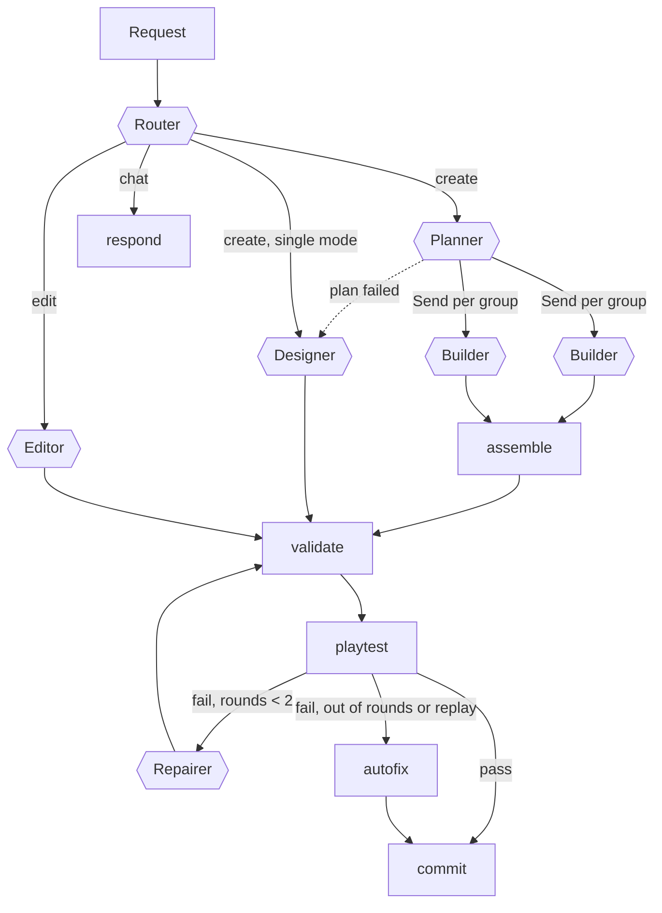

# Agent architecture

**Decision: a code-orchestrated multi-agent workflow in LangGraph.js.** A state
graph decides what runs next in plain code; LLM agents sit only in the slots
that need judgment. No LLM supervisor. One model call on the happy path keeps
voice requests fast and demos predictable, and every step is visible.

## Options considered

| Pattern | Model calls per request (rough) | Predictability | Verdict |
| --- | --- | --- | --- |
| Single ReAct agent looping over tools | 4–8 | Low | Too slow for voice |
| Supervisor LLM delegating to specialists | 6–12 | Lowest | Misses the 10 s budget |
| **Code-orchestrated workflow + specialist agents** | **1**, 2–3 with repairs | High, unit-testable | **Chosen** |

It is still genuinely agentic: the Designer makes open-ended creative choices
and the Repairer is a tool-using agent that inspects test failures and decides
how to fix them. What's removed is an LLM choosing *which step comes next*.

## The graph (`server/graph/graph.ts`)

**Realism loop: research → verify → design → playtest → critique.**
1. **Researcher** finds what the real object looks like: verified library
   (hero objects, instant) → per-process cache → web-grounded search (Meta
   Responses API `web_search` tool, or Gemini `google_search`). Output is a
   reference card: parts, counts, proportions, colours, materials, motion, sources.
2. **Verify** (code) checks the card is about the wish and usable; otherwise the
   Designer works from model knowledge. The headset shows the reference and sources.
3. **Designer** builds from the card with organic shapes (lathe, tube, blob,
   frustum), radial repeats, motion and new styles (jelly, organic, crystal, pearl).
4. **Playtest** taps every part from every side a seated user can reach.
5. **Critic** (separate graph, `POST /api/critique`): after the creation has
   assembled, the headset renders a snapshot; the Critic (multimodal) compares it
   with the wish and the reference, scores it 0–10 and returns realism edits,
   which are validated, playtested and committed as the next version.

New creations use the **single Designer** by default. **Split design**
(`DESIGN_MODE=split`) is available: a
Planner decides the groups of parts (no numbers), the headset shows a
placeholder ghost per group, and one Builder per group fills it in **in
parallel** via LangGraph `Send`. A creation takes about as long as its slowest
group. If planning fails, the single Designer runs instead. Measured on
Muse Spark 1.2 (Nov 13): split ≈ 39 s vs single ≈ 18 s for the jellyfish,
because every call pays the model's long hidden-reasoning start-up and planner
and builders are sequential. Worth retrying with a faster planner model. Simple edits (size, colour, glow, palette, style) skip the model.

Hexagons are LLM agents; rectangles are code.

## Agents

| Agent | File | Job | Output | Reasoning |
| --- | --- | --- | --- | --- |
| Researcher | `agents/researcher.ts`, `research/` | what the real object looks like (web-grounded) | reference card + sources | `minimal` |
| Critic | `agents/critic.ts` | snapshot + reference → score, verdict, realism edits | structured `{score, verdict, ops}` | `low` |
| Router | `agents/router.ts` | create / edit / chat, resolve "that one" | structured `{intent, targetPartId, reply}` | rules first, LLM only if ambiguous; `minimal` |
| Planner | `agents/planner.ts` | wish → title, look, 1–5 groups with coarse locations | structured `Plan` | `minimal` |
| Builder | `agents/builder.ts` | one group → parts inside its box (parallel) | NDJSON part lines, `repeat` for rows | `minimal` |
| Designer | `agents/designer.ts` | wish → whole creation (single mode / fallback) | NDJSON stream: header, then one part per line | `minimal` |
| Editor | `agents/editor.ts` | change request → edit ops; simple restyles handled by rules with no model call | structured `{ops, reply}` | `minimal` |
| World Planner | `agents/world.ts`, `prompts/world.ts` | places ("a snowy village"): a Holodeck-style **scene plan** (asset groups, counts, sizes, spatial relations: around / near / row / scattered / shore / water / sky, zones) **plus the story**, never coordinates; `src/spec/scene.ts` solves the layout | structured `ScenePlan` → `solveScene` (deterministic, real-world sizes, no overlaps, dry land, clear sightline from the spawn) → parts streamed, `story` event; skips playtest/repair | `minimal` (planner model) |
| Story Director | `agents/story.ts`, `prompts/story.ts` | the story a world is played through, built from its parts: intro, chapters (target part, places with directions, arrive / payoff lines), ending | structured `Story` (`src/spec/story.ts`), fixed up by `fixStory`; template story offline | `minimal` (planner model) |
| Narrator (not an agent) | `server/tts.ts` | speaks story lines with Gemini TTS (`POST /api/speak`, WAV, cached) | audio | n/a |
| Area builder | `agents/area.ts`, `prompts/area.ts` | one new area of an endless world (or the wish the user made inside it), knowing the world, its kit, the direction and nearby areas | NDJSON stream: area title, then parts; `POST /api/area`, rate-limited | `minimal` (designer model) |
| Repairer | `agents/repairer.ts` | fix playtest failures | tool loop: `get_spec`, `apply_edits`, `playtest` (≤4 rounds per call, ≤2 calls) | `medium` |

## Code nodes (`server/graph/nodes.ts`)

- **validate**: zod + engine rules (play zone, size clamps, sounds).
- **playtest**: virtual fingertip taps every interactive part using the
  headset's `verbs.ts`; reports untriggerable, covered and ambiguous parts.
- **autofix**: deterministic fixes when out of repair rounds or in replay mode.
- **commit**: stamps the version, sends the final spec.
- **respond**: chat replies.
- **verify**: checks the reference card matches the wish before the Designer uses it.

## State and streaming

- Stateless server: the headset sends the current spec each time. No database
  or checkpointer in production.
- State: `request`, `intent`, `targetPartId`, `draft`, `issues`,
  `repairRounds`, `reply`, `source` (`live` / `fixture`).
- Nodes emit events with LangGraph's custom stream writer
  (`streamMode: 'custom'`); `server/http.ts` turns them into server-sent events.
- Whole-request budget: 25 s (`REQUEST_BUDGET_MS`).

## Replay (fixture) mode

With no API key, every role runs in replay mode: the Designer streams a
matching preset, the Editor handles resize / recolour / restyle with rules, and
repairs use `autofix`. Events and the commit are labelled `source: "fixture"`.
This keeps the app demoable offline and is the "take it away" answer.
